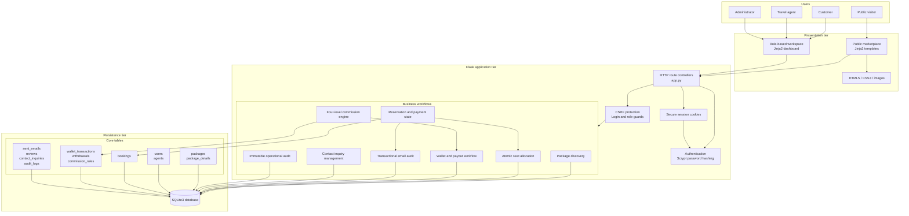
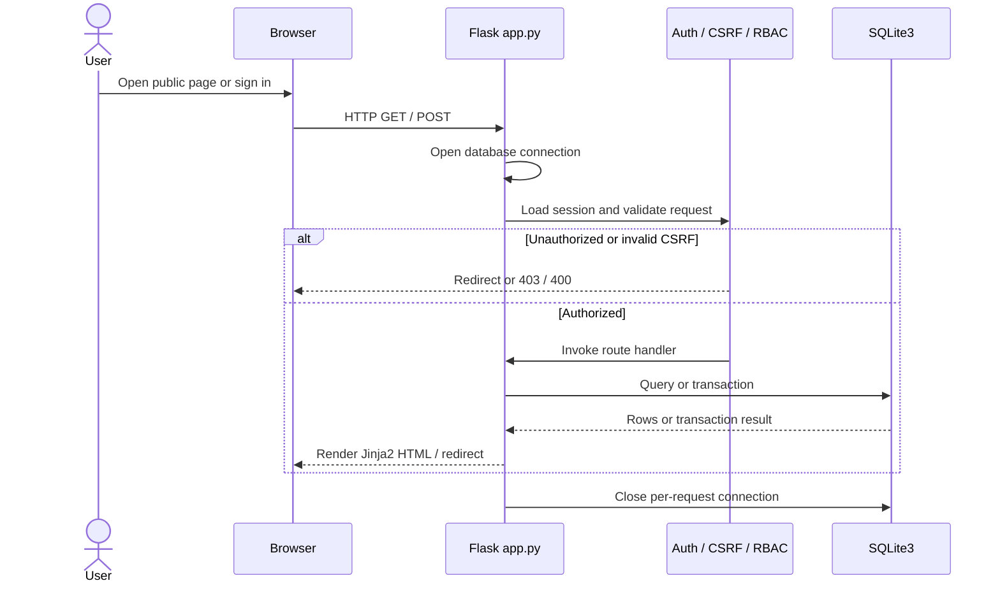
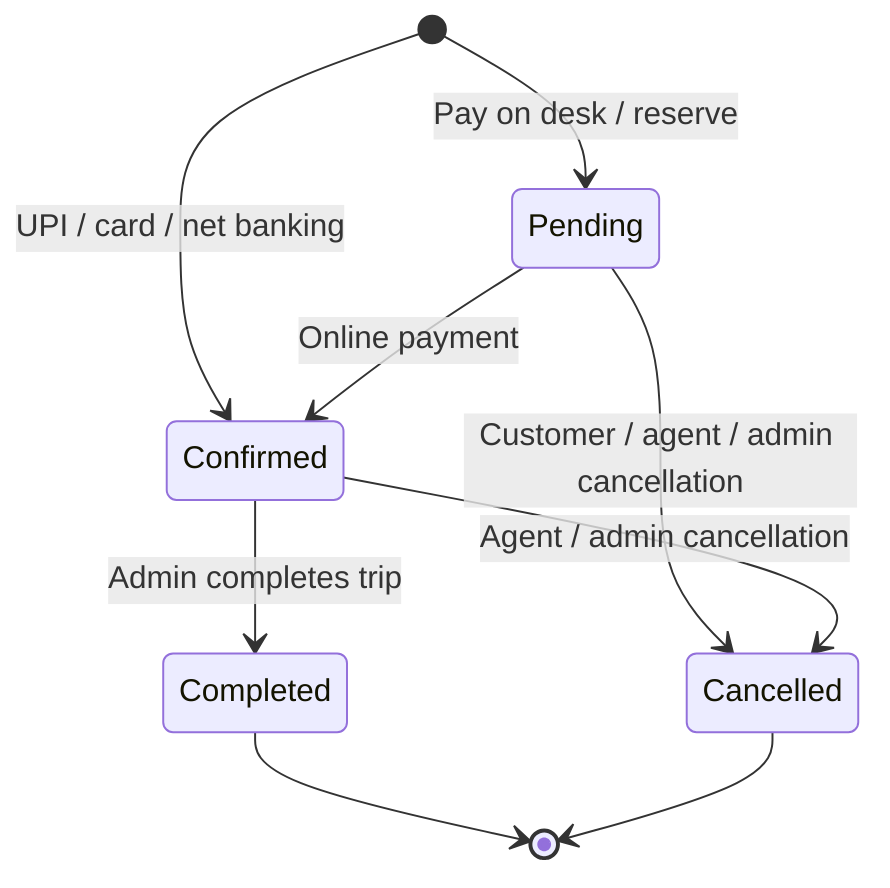

# Wanderwise Travel ERP Architecture

## System Overview



## Request Flow



## Booking Lifecycle



The booking workflow:

1. Reads an active package and checks available capacity.
2. Allocates seats atomically by updating `reserved` in the database.
3. Creates a booking with its travel dates, traveller count, total in paise, payment details, and optional agent referral.
4. Logs the confirmation or reservation email in `sent_emails`.
5. Allows an admin to complete confirmed trips.
6. Walks the agent upline and credits four commission levels based on `commission_rules`.

Cancelled bookings restore their reserved seat count. Monetary values use integer paise rather than floating-point currency values.

## Relational Model

```mermaid
erDiagram
    USERS ||--o| AGENTS : "has partner profile"
    USERS ||--o{ BOOKINGS : "places"
    USERS ||--o{ REVIEWS : "writes"
    USERS ||--o{ AUDIT_LOGS : "performed"

    AGENTS ||--o{ AGENTS : "has parent upline"
    AGENTS ||--o{ BOOKINGS : "refers"
    AGENTS ||--o{ WALLET_TRANSACTIONS : "earns or withdraws"
    AGENTS ||--o{ WITHDRAWALS : "requests"

    PACKAGES ||--|| PACKAGE_DETAILS : "has itinerary"
    PACKAGES ||--o{ BOOKINGS : "reserved by"

    BOOKINGS ||--o| REVIEWS : "has"
    BOOKINGS ||--o{ SENT_EMAILS : "generates"

    USERS {
        integer id PK
        text name
        text email UK
        text password_hash
        text role
        text created_at
    }

    AGENTS {
        integer id PK
        integer user_id FK
        text code UK
        integer level
        integer parent_id FK
    }

    PACKAGES {
        integer id PK
        text title
        text destination
        text category
        integer price_paise
        integer capacity
        integer reserved
        text status
    }

    PACKAGE_DETAILS {
        integer package_id PK_FK
        text stay_type
        text meal_plan
        text transport
        text inclusions
        text itinerary
    }

    BOOKINGS {
        integer id PK
        text reference UK
        integer customer_id FK
        integer agent_id FK
        integer package_id FK
        text travel_date
        text return_date
        integer travellers
        integer total_paise
        text status
        text payment_method
        text payment_ref
    }

    WALLET_TRANSACTIONS {
        integer id PK
        integer agent_id FK
        integer amount_paise
        text kind
        text reference
    }

    WITHDRAWALS {
        integer id PK
        integer agent_id FK
        integer amount_paise
        text status
        integer reviewed_by FK
    }

    COMMISSION_RULES {
        integer level PK
        integer rate_bps
    }
```

## Runtime and Deployment

- **Runtime:** Python 3.10+ and Flask 3.x.
- **Application server:** Development server started by `python app.py` or `run.bat`.
- **Database:** Local SQLite3 file (`travel_erp.sqlite3`) with foreign keys enabled.
- **Presentation:** Server-side Jinja2 templates plus CSS and static image assets.
- **Seed scripts:** `seed_data.py` maintains package catalog and `seed_real_world.py` creates demo operational data.
- **Configuration:** Optional `TRAVEL_ERP_DATABASE`, `TRAVEL_ERP_SECRET`, and `TRAVEL_ERP_HTTPS` environment variables.
