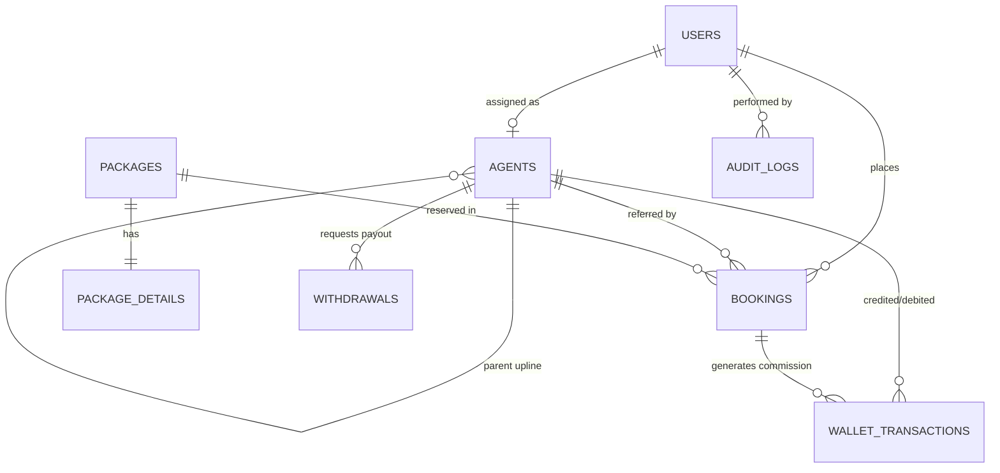

# Wanderwise Travel ERP

> **Enterprise Indian Travel Commerce & Agency Operations ERP Platform**  
> Built with Python, Flask, SQLite3, HTML5, CSS3, and modern responsive design.

[](https://www.python.org/)
[](https://flask.palletsprojects.com/)
[](https://www.sqlite.org/)
[](LICENSE)

---

## 🌟 Overview

**Wanderwise Travel ERP** is a full-featured travel agency enterprise resource planning prototype designed specifically for Indian tourism, heritage landmarks, and pilgrimage circuits.

It bridges visitor-facing travel discovery with complete back-office ERP operations, featuring:
- **Public Travel Marketplace**: High-definition landmarks photo marquee gallery, package search, detailed day-by-day itineraries with official government tourism links, and transparent policy checklist cards.
- **Executive Administrator Command Center**: Real-time KPI analytics (gross volume, confirmed travellers, seat inventory), package activation/archival toggles, and new package publishing.
- **Master Reservations Ledger**: Full booking lifecycle state machine (`pending` → `confirmed` → `completed` → `cancelled`) with 1-click administrative actions.
- **Multi-Level Partner Network (MLM Hierarchy)**: 4-tier commission ladder with recursive downline team tracking and unique referral codes (`WW-1001` to `WW-1006`).
- **Double-Entry Wallet Ledger & Payout Queue**: Automated commission distribution on trip completion, available vs. reserved balance tracking, and bank settlement recording with official UTR numbers.
- **Inbound Guest Support Desk**: Customer inquiry management with direct 1-click `mailto` reply and resolution workflows.
- **Prominent Multi-Location Sign Out**: Unmistakable session controls across topbar, sidebar, profile drawer, and public headers.

---

## 🔑 Verified Live Sample Credentials

The system includes pre-configured, authentic accounts for all operational tiers with zero fake bookings pre-seeded:

| Role & Tier | Representative Name & Agency | Login Email | Password | Partner Code | Tier / Function |
| :--- | :--- | :--- | :--- | :--- | :--- |
| **👤 Real Customer** | **Lokesh M M Ankith** (*Verified Customer*) | `lokeshmmankith@gmail.com` | `Lokesh@123` | *Guest* | **Direct User Booking & Payment** |
| **👑 Administrator** | **Aarav Mehta** (*Head of Operations*) | `admin@wanderwise.local` | `Admin@123` | `HQ-ADMIN-01` | Executive HQ Controls & Master Ledger |
| **💼 Principal Partner** | **Priya Sharma** (*Apex Travel Holidays*) | `agent@wanderwise.local` | `Agent@123` | `WW-1001` | **Tier 4** (0.5% Apex Override) |
| **💼 Senior Partner** | **Rohan Das** (*Odyssey India Tours*) | `rohan@wanderwise.local` | `Agent@123` | `WW-1002` | **Tier 3** (1.0% Senior Override) |
| **💼 Associate Partner** | **Nisha Rao** (*Deccan Voyages*) | `nisha@wanderwise.local` | `Agent@123` | `WW-1003` | **Tier 2** (2.0% Upline Override) |
| **💼 Junior Partner** | **Kabir Singh** (*Heritage Trails Punjab*) | `kabir@wanderwise.local` | `Agent@123` | `WW-1004` | **Tier 1** (5.0% Direct Booking) |
| **✈️ Verified Customer** | **Maya Kapoor** (*Traveller - Mumbai*) | `customer@wanderwise.local` | `Travel@123` | *Guest* | Active Itineraries & Reviews |

*(On the sign-in screen, use the **1-Click Quick Demo Login** buttons: 👑 Admin, 💼 Partner, 👤 Lokesh, or ✈️ Traveller to pre-fill credentials instantly).*

---

## 💳 Real-World Booking, Payment Options & Agent Controls

### 1. 100% Real Live Data (Zero Fake Pre-seeded Bookings)
- The database starts with **0 dummy bookings**, **0 dummy transactions**, and **0 dummy withdrawals**.
- When a user (such as Lokesh) reserves a trip, **only that authentic booking is registered** in the database.
- If booked directly by the customer, it appears only under the customer and admin ledgers.
- If booked through an agent's referral code (e.g., `WW-1001`), the booking is attributed specifically to that agent's agency and appears in their dashboard.

### 2. Multi-Option Payment Gateway Checkout
When booking on the package details page (`/trips/<id>`) or dashboard:
- **⚡ Instant UPI (GPay / PhonePe / Paytm / BHIM)**: Enter UPI ID for immediate payment verification.
- **💳 Credit / Debit Card (Visa / MasterCard / RuPay)**: Enter card details with CVV and expiry for immediate processing.
- **🏦 Net Banking (All Indian Banks)**: Select bank (SBI, HDFC, ICICI, Axis, PNB) with instant verification.
- **⏳ Pay Later (Pay on Desk)**: Reserves seats with `pending` status, allowing payment later via UPI.
- Selecting any online payment instantly assigns an official transaction reference (e.g. `PAY-UPI-98B2`, `PAY-CRD-7A1C`) and marks the booking `confirmed`.

### 3. Agent Manual Cancellation & Inventory Sync
- Agents can view all client bookings attributed to their agency code.
- If a client requests cancellation, the agent can click **Cancel booking ✕** directly from their bookings ledger.
- The system automatically marks the booking `cancelled` and atomically restores the reserved seat capacity (`UPDATE packages SET reserved = MAX(0, reserved - ?)`).

### 4. Seamless Homepage Logout Redirection
- Logging out via the navigation bar, sidebar, or profile menu destroys the session and immediately redirects the user to the main public website homepage (`/`), providing a natural browsing experience.

---

## 🏛️ System Architecture

```
┌─────────────────────────────────────────────────────────────────────────────┐
│                       Client Presentation Tier                              │
│   • Jinja2 Server-Side Rendered Templates (SSR)                             │
│   • Typography: DM Sans (Headings) & Manrope (Body)                         │
│   • Interactive Policy Checklist Cards & Landmark Photo Marquee Showcase   │
│   • Glassmorphic Navigation, Responsive Tables, & 1-Click Role Switcher     │
└──────────────────────────────────────┬──────────────────────────────────────┘
                                       │ HTTP / Secure Session Cookies
┌──────────────────────────────────────▼──────────────────────────────────────┐
│                    Application & Business Logic Tier (Flask 3.x)             │
│   • Route Controllers: Public Discovery, Bookings, Agent Network & HQ Desk  │
│   • Cryptographic CSRF Tokens: Validated on all state-mutating POST requests│
│   • Role-Based Access Control: @login_required, @roles_required('admin')    │
│   • Password Hashing: Scrypt with salt via Werkzeug Security                │
│   • Concurrency Guard: Atomic seat allocation preventing overbooking       │
│   • Recursive Multi-Level Commission Distribution Engine                    │
└──────────────────────────────────────┬──────────────────────────────────────┘
                                       │ SQLite Native Driver (WAL Mode)
┌──────────────────────────────────────▼──────────────────────────────────────┐
│                   Persistence & Relational Database Tier                    │
│   • SQLite3 with Foreign Keys & Write-Ahead Logging (WAL) Enabled           │
│   • users: Authentication, role separation (customer, agent, admin)         │
│   • agents: Multi-level referral tree with self-referencing parent_id       │
│   • packages & package_details: Inventory, capacity, day-by-day itineraries │
│   • bookings: Real-world reservations, payment methods & transaction refs   │
│   • wallet_transactions & withdrawals: Double-entry ledger (integer paise)  │
│   • audit_logs & contact_inquiries: Tamper-evident operational trail        │
└─────────────────────────────────────────────────────────────────────────────┘
```

### Relational Entity-Relationship Diagram



---

## 💰 Multi-Level Commission Calculation Logic

When a tour package booking is completed by the travel desk, the commission engine distributes commissions up the referring agent's upline network across **up to 4 generations**.

### 1. Commission Ladder & Basis Points (BPS)
All rates are represented in **Basis Points (1 BPS = 0.01% = 1/10,000)** to guarantee exact integer calculations in paise without floating-point inaccuracies:

| Referral Tier | Hierarchy Level | Basis Points | Percentage Rate | Role Description |
| :--- | :--- | :--- | :--- | :--- |
| **Tier 1** | Direct Booking Agent | `500 bps` | **5.00%** | The partner directly registering or referring the booking |
| **Tier 2** | Direct Parent (L1 Upline) | `200 bps` | **2.00%** | The direct mentor/sponsor of the booking partner |
| **Tier 3** | Senior Partner (L2 Upline) | `100 bps` | **1.00%** | Regional senior partner overseeing the agency cluster |
| **Tier 4** | Principal Partner (L3 Upline) | `50 bps` | **0.50%** | Apex principal partner at the root of the network |
| **HQ Retained** | Wanderwise Operations | `9150 bps` | **91.50%** | Platform gross margin covering vendor costs & operations |

### 2. Core Python Algorithm (`app.py`)

```python
# Multi-Level Commission Calculation Loop (app.py)
agent_id = booking["agent_id"]
depth = 1

while agent_id and depth <= 4:
    rule = g.db.execute(
        "SELECT rate_bps FROM commission_rules WHERE level=?", (depth,)
    ).fetchone()
    
    if rule:
        # Integer math ensures 0 floating-point rounding errors (calculated in paise)
        cut = (booking["total_paise"] * rule["rate_bps"]) // 10000
        if cut > 0:
            g.db.execute(
                """INSERT INTO wallet_transactions
                   (agent_id, booking_id, amount_paise, kind, reference)
                   VALUES (?, ?, ?, 'commission', ?)""",
                (agent_id, booking["id"], cut, f"COMM-{booking['reference']}-L{depth}")
            )
            
    # Traverse to direct parent upline
    agent = g.db.execute(
        "SELECT parent_id FROM agents WHERE id=?", (agent_id,)
    ).fetchone()
    agent_id = agent["parent_id"] if agent else None
    depth += 1
```

### 3. Worked Mathematical Example

Consider a booking for 2 guests on the **Kedarnath & Badrinath Sacred Do Dham Yatra**:
- Package Price per Traveller: **₹28,500.00** (2,850,000 paise)
- Guests: **2**
- **Total Gross Booking Volume**: ₹28,500 × 2 = **₹57,000.00** (`5,700,000 paise`)

Referred by **Kabir Singh (`WW-1004`)** whose upline chain is:
`Kabir Singh (Tier 1)` → `Nisha Rao (Tier 2)` → `Rohan Das (Tier 3)` → `Priya Sharma (Tier 4)`

The engine computes:
- **Tier 1 (Kabir Singh, `WW-1004`)**:
  $$\frac{5,700,000 \times 500}{10,000} = 285,000\text{ paise} = \mathbf{₹2,850.00}$$
- **Tier 2 (Nisha Rao, `WW-1003`)**:
  $$\frac{5,700,000 \times 200}{10,000} = 114,000\text{ paise} = \mathbf{₹1,140.00}$$
- **Tier 3 (Rohan Das, `WW-1002`)**:
  $$\frac{5,700,000 \times 100}{10,000} = 57,000\text{ paise} = \mathbf{₹570.00}$$
- **Tier 4 (Priya Sharma, `WW-1001`)**:
  $$\frac{5,700,000 \times 50}{10,000} = 28,500\text{ paise} = \mathbf{₹285.00}$$

**Summary**:
- Total Network Commission Disbursed: **₹4,845.00** (8.50%)
- Net Wanderwise Retained Gross Margin: **₹52,155.00** (91.50%)

---

## 📸 Screenshots & Demonstration Guide

### Live Feature Walkthrough

#### 1. Public Marketplace & Photo Marquee
- Visit `http://127.0.0.1:5000/`.
- Browse the interactive **India Landmarks Photo Marquee Gallery** (Somnath Temple, Statue of Unity, Golden Temple, Taj Mahal, Mysore Palace).
- Inspect the **Booking & Travel Policies** interactive checklist cards.

#### 2. Customer Booking & Payment Checkout
- Sign in with **👤 Lokesh** (`lokeshmmankith@gmail.com` / `Lokesh@123`).
- Select any package (e.g. *Taj Mahal & Mughal Splendour* or *Into the Himalayas*).
- Choose travel date, number of travellers, and select your preferred payment option:
  - **⚡ Instant UPI**: Enter your UPI ID (e.g., `lokesh@oksbi`).
  - **💳 Card**: Enter test card number.
  - **🏦 Net Banking**: Select bank.
  - **⏳ Pay on Desk**: Reserve now and pay later.
- Submit booking: notice instant confirmation with an official payment reference (e.g., `PAY-UPI-XXXX`), and seat capacity reserved.

#### 3. Agent Dashboard & Manual Booking Cancellation
- Sign in with **💼 Partner** (`agent@wanderwise.local` / `Agent@123`).
- View referred customer bookings attributed to agency code `WW-1001`.
- Direct bookings by unrelated customers are kept private.
- If a client requests cancellation, click **Cancel booking ✕**.
- Status updates immediately to `cancelled`, and the package's reserved seats are restored.

#### 4. Executive Admin Command Center
- Sign in with **👑 Admin** (`admin@wanderwise.local` / `Admin@123`).
- View real-time gross volume, confirmed bookings count, and active packages.
- View the Master Reservations Ledger with payment methods and transaction references.
- Mark journeys as **Complete trip ↗** to trigger automated upline commission distribution.

#### 5. Clean Sign Out Flow
- Click **Sign Out** from the top header or sidebar.
- You are immediately redirected to the public website homepage (`/`).

---

## 🚀 Quick Start Guide

### 1. Prerequisites
- Python 3.10 or higher
- Git

### 2. Clone and Setup
```bash
git clone https://github.com/Lokesh206/Travel-ERP.git
cd Travel-ERP
```

### 3. Install Dependencies
```bash
pip install -r requirements.txt
```

### 4. Run Application
```bash
# Windows
run.bat
# or
python app.py
```

Open `http://127.0.0.1:5000` in your web browser.

---

## 📁 Project Structure

```
Travel-ERP/
├── app.py                  # Core Flask application, routing, auth & commission engine
├── seed_data.py            # Package inventory & initial data
├── seed_real_world.py      # Production-grade Indian bookings, agents, inquiries & reviews
├── requirements.txt        # Minimal Python dependencies (Flask, Werkzeug)
├── run.bat                 # 1-click Windows runner
├── static/
│   ├── style.css           # Global typography & layout system
│   ├── landing.css         # Public showcase, search filters & hero
│   ├── workspace.css       # Enterprise dashboard layout & table components
│   ├── enhancements.css    # Admin command center, marquee, login background & guide
│   └── *.jpg               # High-res landmarks, gallery & background photos
└── templates/
    ├── public_home.html    # Visitor portal, photo marquee & policy checklist
    ├── trip_details.html   # Day-by-day itinerary, inclusions & booking form
    ├── login.html          # Incredible India auth portal with 1-click role switcher
    ├── dashboard.html      # Complete Executive Command Center & Architecture Guide
    └── error.html          # User-friendly error boundary
```

---

## 🛡️ Security & Integrity Highlights
- **Cryptographic CSRF Validation**: Enforced across every state-changing POST endpoint.
- **Double-Entry Wallet Bookkeeping**: Commission accruals and withdrawal settlements are strictly logged with integer paise precision to prevent float rounding errors.
- **Immutable Audit Trail**: Security ledger recording actor IDs, action verbs, record IDs, and timestamps.
- **Role-Based Guards**: Decorator-enforced authorization (`@roles_required("admin")`, `@roles_required("agent")`).

---

## 📜 License
Distributed under the MIT License. See `LICENSE` for more information.
